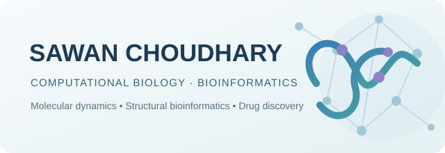
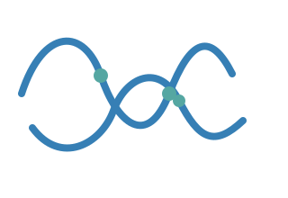
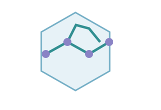
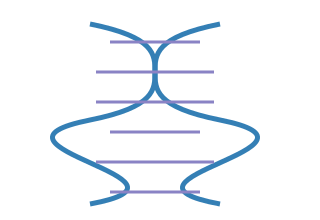
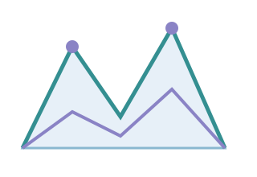
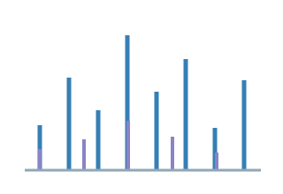
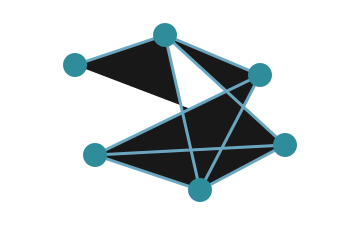

**Bioinformatics & Biotechnology | Computational Drug Discovery**

*Exploring biological systems through computation.*

---

## About

I am a Bioinformatics and Biotechnology student interested in applying computational methods to biological questions. My current focus is on **molecular dynamics simulations, computational drug discovery, structural bioinformatics, and bioinformatics**.

I enjoy building reproducible computational workflows, analysing molecular interactions, and connecting computational results with biological interpretation.

**Currently exploring**
- Molecular dynamics and enhanced sampling
- Protein-ligand interactions and binding energetics
- Free-energy calculations and metadynamics
- Computational proteomics and mass spectrometry
- Machine learning applications in drug discovery

---

## Research Interests

<table>
<tr>
<td width="33%" valign="top" align="left">

<strong>Molecular Dynamics</strong> 
Protein dynamics, molecular interactions, conformational changes, and biomolecular simulations.
</td>
<td width="33%" valign="top" align="left">

<strong>Computational Drug Discovery</strong> 
Molecular docking, binding affinity, free-energy calculations, and structure-based drug design.
</td>
<td width="33%" valign="top" align="left">

<strong>Bioinformatics</strong> 
Sequence analysis, structural bioinformatics, biological databases, and computational genomics.
</td>
</tr>
<tr>
<td width="33%" valign="top" align="left">

<strong>Enhanced Sampling</strong> 
Metadynamics, collective variables, reweighting, and free-energy landscapes.
</td>
<td width="33%" valign="top" align="left">

<strong>Computational Proteomics</strong> 
LC-MS/MS analysis, peptide identification, FDR filtering, protein inference, and quantification.
</td>
<td width="33%" valign="top" align="left">

<strong>AI/ML in Biology</strong> 
Machine learning and data-driven approaches for biological discovery and drug development.
</td>
</tr>
</table>

---

## Selected Projects

<table>
<tr>
<td width="50%" valign="top">
<h3>01 · Molecular Dynamics Simulations</h3>

<a href="https://github.com/SawannChoudhary/protein-ligand-md-gromacs"><strong>protein-ligand-md-gromacs ↗</strong></a>

Protein and protein-ligand molecular dynamics workflows using GROMACS, different force fields, and physiological ionic conditions.

GROMACS · Python · Molecular dynamics
</td>
<td width="50%" valign="top">
<h3>02 · Free Energy & Enhanced Sampling</h3>

<a href="https://github.com/SawannChoudhary/molecular-dynamics-free-energy"><strong>molecular-dynamics-free-energy ↗</strong></a>

Exploration of enhanced sampling and free-energy analysis using GROMACS and PLUMED, including metadynamics, collective variables, and reweighting.

GROMACS · PLUMED · Free-energy analysis
</td>
</tr>
<tr>
<td width="50%" valign="top">
<h3>03 · Computational Proteomics</h3>

<a href="https://github.com/SawannChoudhary/OpenMS-Proteomics-Analysis"><strong>OpenMS-Proteomics-Analysis ↗</strong></a>

LC-MS/MS proteomics workflow involving OpenMS, MS-GF+, peptide identification, FDR filtering, protein inference, and quantification.

OpenMS · MS-GF+ · Proteomics
</td>
<td width="50%" valign="top">
<h3>04 · Genetic Code Translator</h3>

<a href="https://github.com/SawannChoudhary/genetic-code-translator"><strong>genetic-code-translator ↗</strong></a>

Python tool for translating DNA and RNA sequences into amino-acid sequences using the standard genetic code.

Python · Sequence analysis · Bioinformatics
</td>
</tr>
</table>

[**Browse all repositories →**](https://github.com/SawannChoudhary?tab=repositories)

---

## Computational Toolkit

**Molecular Simulation & Structural Biology**

**Programming & Data Analysis**

**Bioinformatics & Proteomics**

---

## Research Workflow

<table>
<tr>
<td align="center" width="25%">
<strong>01</strong>  
<strong>Biological question</strong> 
Define the problem and biological context.
</td>
<td align="center" width="25%">
<strong>02</strong>  
<strong>Method selection</strong> 
Choose suitable computational methods.
</td>
<td align="center" width="25%">
<strong>03</strong>  
<strong>Analysis</strong> 
Run workflows and evaluate results.
</td>
<td align="center" width="25%">
<strong>04</strong>  
<strong>Interpretation</strong> 
Relate computational findings to biology.
</td>
</tr>
</table>

---

## Current Learning Focus

- Advanced molecular dynamics and enhanced-sampling methods
- Protein-ligand interactions and binding free-energy calculations
- Structural bioinformatics and computational proteomics
- Reproducible scientific computing and workflow development
- Machine learning applications in computational biology

## GitHub Activity

---

**Open to thoughtful conversations and research collaborations in computational biology.**

[GitHub](https://github.com/SawannChoudhary) · [LinkedIn](https://www.linkedin.com/in/sawannchoudhary/) · [Email](mailto:sawanchoudhary584@gmail.com)

**India 🇮🇳**

Learning, building, and investigating biological systems through computation.

